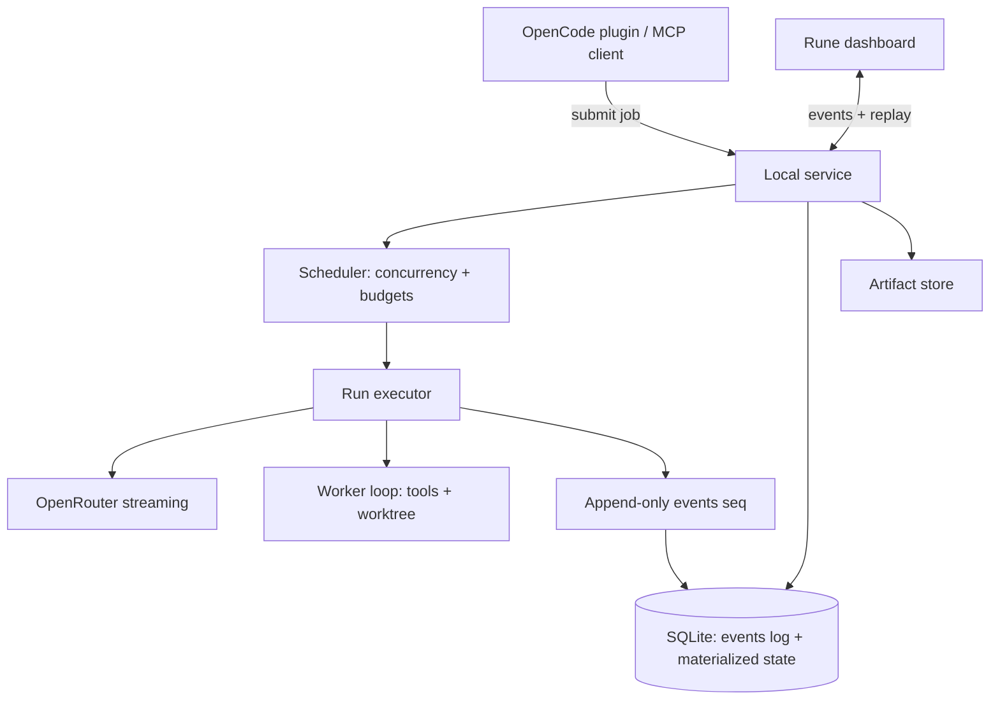

# SWITCHBOARD — Visible Model Delegation - Plan

## Goal Capsule

- **Objective:** A user can tell their assistant "have Argon plan this and two other models critique it," keep working, reconnect the dashboard later, inspect exactly what each model saw, cancel one run, and collect the other two results — with full history intact.
- **Means:** A local Rust service that owns jobs end-to-end (SQLite event log + materialized state), an OpenCode host plugin, a Rune live dashboard, and a portable MCP interface (KTD1–KTD3).
- **Authority:** `docs/BRIEF.md` governs product scope and the honesty rules; this plan governs implementation; `AGENTS.md` and `duketopceo/luke-agents` govern standards.
- **Stop conditions:** the first-release gate in the brief passes — three delegates, host keeps working, reconnect without resubmission, inspect inputs, cancel one, retrieve two.
- **Execution profile:** `ce-work` consumes Implementation Units in order; adapter spikes (U3–U4) may reorder within Phase 0/1.
- **Who finishes:** implementing agent builds units; owner validates the release gate inside OpenCode.

---

## Product Contract

### Summary

SWITCHBOARD is a persistent delegation workspace, not an MCP wrapper. A local service owns every job — scheduling, credentials, an append-only event log, cancellation, budgets — while hosts (OpenCode first, others via MCP) submit work and a Rune dashboard streams each delegate's observable execution. Consult mode is read-only; worker mode runs a tool-using agent in an isolated workspace.

### Problem Frame

"Ask another model" is trivial; durable delegation is not. Today, delegating to parallel models means babysitting terminal sessions that die with the conversation, with no shared record of what each model saw, what it cost, or what it produced. SWITCHBOARD makes delegation a first-class, inspectable, resumable job.

### Key Decisions

- **Service owns the job.** No plugin process, terminal, or dashboard is the durable owner — closing any client must not kill a run. Governs R1, R2.
- **Observable execution only.** The dashboard shows streamed output, exposed reasoning where available, tool calls, artifacts — never a fabricated thinking transcript. Governs R13–R15.
- **Consult and worker are different modes.** Calling a model does not grant a coding harness; worker mode supplies the tool loop explicitly. Governs R8, R9.
- **First two batch modes only.** Parallel panel and task fan-out ship first; pipeline and deferred batch follow. Governs R10–R12.
- **Honest accounting.** Requested vs actual config, estimated vs reconciled cost, requested/locally-stopped/provider-confirmed cancellation — `unknown` is a valid value everywhere. Governs R16–R19.

### Requirements

**Service and durability**

- R1. A local service owns jobs: submission, scheduling, persistence, cancellation, provider connections, credentials.
- R2. An append-only event log with sequence numbers backs every run; materialized job state is derived, never authoritative.
- R3. Event stream supports reconnect/replay with bounded buffers; independent state per child run; dashboard reconnect never resubmits a model request.
- R4. Jobs, runs, and parent tasks have stable IDs returned to the host immediately at submission.

**Delegation modes**

- R5. Consult mode sends selected context to a model for plan/critique/explanation/document; read-only by default.
- R6. Worker mode runs a tool-using agent with explicit working directory, permission policy, command policy, and artifact output.
- R7. Worker delegates execute in isolated worktrees or sandboxes; write-capable runs never share the user's checkout.
- R8. Model aliases (e.g., "Argon") resolve to verified model identifiers — no guessed OpenRouter slugs.

**Batch modes**

- R9. Parallel panel sends identical frozen context to several models independently.
- R10. Task fan-out assigns different bounded tasks concurrently.
- R11. Pipeline mode (artifact→input chaining) and deferred batch queue are supported as explicit later modes, not implied equivalents of foreground streaming.
- R12. Context snapshots are saved per batch; the UI shows whether delegates received identical inputs and separates independent from influenced reviews.

**Dashboard**

- R13. Live delegate cards show model alias, state, current activity, elapsed, usage, estimated/final cost, warnings.
- R14. Cards link to full event timeline and input manifest (prompt version, files, commit, content hashes, exclusions).
- R15. Dashboard remains useful in a narrow side panel; no dependence on host conversation state.
- R16. Observable events only: streamed output, provider-exposed reasoning where available, tool calls/results, artifacts, state transitions. No reasoning exposed → UI says so.

**Data and accounting**

- R17. Records cover identity, inputs, configuration, execution, accounting, artifacts, evaluation — per the brief's data groups.
- R18. Missing fields render `unknown`; requested config and actual reported behavior are separate fields (routing/fallback visible).
- R19. Sanitized records by default; raw payload retention is explicit opt-in; secrets never enter model-readable workspaces.
- R20. Budget controls: per-run and per-job ceilings, concurrency limits, approval before paid fallback.
- R21. Cancellation distinguishes requested / locally stopped / provider-confirmed.

**Hosts**

- R22. OpenCode integration packages selected context, submits jobs, exposes results inside the host.
- R23. Portable MCP interface lets other compatible hosts submit and inspect the same jobs.
- R24. Cross-harness capability tracked as a matrix (tools, async, progress, notifications, artifacts, install) — never marketed beyond actual tier.

**Validation**

- R25. Release gate: three delegates launched, host keeps working, dashboard reconnects, inputs inspected, one run cancelled, two results retrieved with history intact.

### Actors

- **A1 — Operator (primary user):** submits delegation requests from a host, watches the dashboard, reviews artifacts.
- **A2 — Delegate models:** receive frozen context via OpenRouter; produce output/artifacts; never see credentials or unapproved context.
- **A3 — Host harness (OpenCode, later others):** submits jobs and renders results; never owns execution.
- **A4 — Local service:** the durable owner — scheduler, event log, budgets, cancellation.

### Key Flows

- F1. Host submits job → service returns job ID → scheduler fans out runs → events stream to dashboard → results + artifacts retrievable after host moves on.
- F2. Parallel panel: frozen context snapshot → N independent runs → comparison view shows identical-input hash and per-model outputs.
- F3. Cancel: operator requests → service stops locally → provider confirmation tracked → billing state honestly reported.

### Acceptance Examples

- AE1. Given three delegates submitted from OpenCode, when the user closes the terminal and reopens the dashboard, then all three runs show correct state and full history — no resubmission.
- AE2. Given a worker delegate with write scope, when it produces changes, then they land as a patch in an isolated worktree the user can review — never in the user's checkout.
- AE3. Given a provider that exposes no reasoning tokens, when the card renders, then it displays "no reasoning exposed" rather than an invented trace.
- AE4. Given a run exceeding its budget ceiling, when the ceiling trips, then the run pauses for approval before any paid fallback.

### Scope Boundaries

**Deferred for later:** pipeline and deferred-batch modes (Phase 3), additional host harnesses beyond OpenCode + MCP, multi-user or hosted deployment, provider-native batch API parity claims.

**Outside this product's identity:** a thin "ask another model" MCP wrapper, a skill that owns execution, fake reasoning streams, guaranteed instant billing-stop on cancellation.

### Sources

- `docs/BRIEF.md` — product brief (requirements origin)
- `https://github.com/anomalyco/rune` + `crates/rune-kit` — dashboard UI (`dev@24bd7bbb`)
- OpenCode plugin/agent surface — **unverified**; U3 is a source-level spike
- OpenRouter API (chat completions, streaming, usage fields, model list) — verified during U4 spike
- `rmcp` (Rust MCP SDK) — candidate for the portable interface; confirm crate maturity in U7

---

## Planning Contract

### Key Technical Decisions

- KTD1. **Service-owned job model.** SQLite append-only `events` table (seq, run_id, kind, payload) + materialized `jobs`/`runs` tables rebuilt by replay. Clients are disposable. (session-settled: user-directed — Rune everywhere; service-ownership is from the brief, non-negotiable.)
- KTD2. **Single Rust binary family, in-process dashboard.** Service core is a library; the Rune dashboard and MCP server are thin binaries over it — same pattern as VEIN/VIVA for consistency, no microservices.
- KTD3. **OpenRouter is the only provider path for v1.** Model aliases resolve through a verified alias table populated from the live `/models` endpoint; routing/fallback events recorded as actual-vs-requested.
- KTD4. **Worker mode = owned agent loop.** SWITCHBOARD supplies the tool loop (read/grep/edit/bash-policy) rather than depending on a host's harness — hosts consume results, they don't execute delegates.
- KTD5. **Isolated worktrees via `git worktree`.** Write-capable delegates get `~/.local/share/switchboard/workspaces/<run-id>`; patches return as artifacts, never pushed.
- KTD6. **Verification spikes before adapter commitment.** OpenCode plugin surface, OpenRouter streaming/usage fields, and `rmcp` crate viability are verified in U3–U4, U7 before dependent units lock in.
- KTD7. **Sanitized-by-default capture.** Event payloads pass a redaction layer (secrets, env, credential paths) unless the job opts into raw retention.

### High-Level Technical Design

Event flow: every state transition, streamed chunk boundary, tool call/result, and artifact write appends an event with a per-run sequence number. Dashboard subscribes from a cursor; reconnect = replay from last seen seq.

### Assumptions

- Rust 1.99.1 toolchain (installed; matches rune's `rust-toolchain.toml`).
- OpenRouter chat-completions streaming exposes usage + model fields needed for accounting (verify in U4).
- OpenCode supports a plugin/extension surface sufficient for context packaging and result display (verify in U3 — fallback: MCP-only host integration for v1).
- `rmcp` crate is viable for the MCP interface; if not, hand-rolled JSON-RPC over stdio is the fallback (decide in U7).
- Single operator, localhost trust boundary — no multi-tenant auth in v1.

### Sequencing

Phase 0 (U1–U5): service core + consult mode + dashboard + MCP — the release-gate slice.
Phase 1 (U6–U7): OpenCode plugin + alias resolution.
Phase 2 (U8–U9): worker mode + task fan-out + evaluation records.
Phase 3 (U10–U11): pipeline + deferred batch + harness matrix.

---

## Implementation Units

| Unit | Title | Files (primary) | Depends on |
|---|---|---|---|
| U1 | Workspace + service skeleton + event log | `Cargo.toml`, `crates/switchboard-db/`, `crates/switchboard-core/` | — |
| U2 | Scheduler + consult runner (OpenRouter streaming) | `crates/switchboard-core/` | U1 |
| U3 | OpenCode surface spike + host contract | `docs/research/`, `crates/switchboard-host/` | U1 |
| U4 | OpenRouter fields spike + alias table | `crates/switchboard-adapters/`, `docs/research/` | U2 |
| U5 | Rune dashboard: jobs, cards, timeline, manifest | `crates/switchboard-ui/` | U2 |
| U6 | OpenCode plugin: context packaging + results | `crates/switchboard-host/` | U3, U5 |
| U7 | Portable MCP interface | `crates/switchboard-mcp/` | U2 |
| U8 | Worker mode: agent loop + worktrees | `crates/switchboard-core/`, `crates/switchboard-worker/` | U2 |
| U9 | Task fan-out + evaluation records | `crates/switchboard-core/` | U8 |
| U10 | Pipeline + deferred batch modes | `crates/switchboard-core/` | U9 |
| U11 | Harness matrix + release hardening | `docs/`, `crates/switchboard-host/` | U10 |

### U1. Workspace + service skeleton + event log

- **Goal:** `cargo build` produces a `switchboard` service binary that accepts a job submission, persists it, and replays events — with zero model calls yet.
- **Requirements:** R1–R4, R17.
- **Files:** `Cargo.toml`, `rust-toolchain.toml`, `crates/switchboard-db/`, `crates/switchboard-core/`, `crates/switchboard-adapters/`, `crates/switchboard-host/`, `crates/switchboard-mcp/`, `crates/switchboard-ui/`.
- **Approach:** workspace crates mirroring VEIN's split (db / core / adapters / host / mcp / ui). `switchboard-db`: `events(seq INTEGER PRIMARY KEY AUTOINCREMENT, run_id, job_id, kind, payload_json, created_at)` append-only + `jobs`/`runs` materialized tables + migrations. Service API in-process first (trait surface), loopback HTTP/WS later only if a second process needs it.
- **Test scenarios:** submit → events appended with monotonic seq; replay from cursor returns identical stream; materialized state rebuilds from log after wipe.
- **Verification:** `cargo build --workspace && cargo test --workspace && cargo clippy --workspace -- -D warnings`.

### U2. Scheduler + consult runner (OpenRouter streaming)

- **Goal:** consult-mode jobs actually call OpenRouter, stream events, and complete with artifacts.
- **Requirements:** R5, R13, R16, R20.
- **Files:** `crates/switchboard-core/src/scheduler.rs`, `crates/switchboard-core/src/runner.rs`, `crates/switchboard-adapters/src/openrouter.rs`.
- **Approach:** scheduler with concurrency limit + per-run/job budget counters (estimated from token usage as it streams); runner wraps OpenRouter chat-completions SSE; every chunk boundary appends an event (bounded — coalesce token deltas, flush on semantic boundaries). Cancellation token checked between chunks.
- **Test scenarios:** mocked stream → events ordered, state transitions queued→running→completed; budget ceiling → run pauses awaiting approval; cancel mid-stream → requested→locally_stopped recorded.
- **Verification:** `cargo test -p switchboard-core -p switchboard-adapters`.

### U3. OpenCode surface spike

- **Goal:** determine exactly how an OpenCode plugin/agent packages context, submits a job, and displays results — before U6 builds on it.
- **Requirements:** R22, R24, KTD6.
- **Files:** `docs/research/opencode-integration.md`, `crates/switchboard-host/`.
- **Approach:** read OpenCode's plugin/tool/agent docs and source at a pinned version; prototype the minimal host contract (submit → job ID → poll/notify → render result). If the plugin surface can't carry async results, fall back to MCP-only for v1 and record the gap in the harness matrix.
- **Test scenarios:** spike notes name the exact OpenCode extension points used; fallback decision recorded with evidence.
- **Verification:** spike doc committed; no code depends on unverified assumptions.

### U4. OpenRouter fields spike + alias table

- **Goal:** verify streaming response fields (model reported, usage, finish reason, citation support) and build the alias→model resolution table.
- **Requirements:** R8, R17, R18, KTD3, KTD6.
- **Files:** `crates/switchboard-adapters/src/models.rs`, `docs/research/openrouter-fields.md`.
- **Approach:** query `/models` live; sample each candidate model for stream fields; alias table is config (`aliases.toml`) mapping user aliases to verified IDs with the verification date. Actual-vs-requested model recorded per run.
- **Test scenarios:** alias resolution fails loudly on unknown alias; response missing usage → `unknown`, never zero; reported model differs from requested → both stored.
- **Verification:** `cargo test -p switchboard-adapters`; spike doc committed.

### U5. Rune dashboard: jobs, cards, timeline, manifest

- **Goal:** live dashboard shows jobs, per-run cards, event timeline, and input manifest — usable in a narrow panel.
- **Requirements:** R13–R15, R16, R26-equivalent (Rune + rune-kit).
- **Files:** `crates/switchboard-ui/src/` (jobs list, run card, timeline, manifest views).
- **Approach:** subscribe to event stream from last seq; cards render state + elapsed + usage + cost (est/final labeled); timeline is the raw event list grouped by kind; manifest shows the frozen input snapshot + hashes. Reconnect path exercised explicitly. rune-kit components first; narrow-panel layout is a hard constraint, verified headlessly.
- **Test scenarios:** headless render with fixture events → element tree contains cards, timeline entries, manifest fields; reconnect mid-stream → no duplicate events, no resubmission.
- **Verification:** `cargo build -p switchboard-ui`; headless PNG/element-tree snapshots in `docs/screens/`.

### U6. OpenCode plugin: context packaging + results

- **Goal:** from inside OpenCode, a user can submit consult/fan-out jobs and see results without leaving the host.
- **Requirements:** R9, R22, R24.
- **Files:** `crates/switchboard-host/` (plugin package per U3 findings), `docs/host-opencode.md`.
- **Approach:** implement the U3-verified contract: context selection → frozen snapshot (files + hashes + exclusions recorded) → submit → return job ID immediately → completion notification → result/artifact links. Sanitization applied before context leaves the host boundary; transmission is explicit.
- **Test scenarios:** submit from host → job ID returned synchronously; context snapshot hash matches what delegates received; private files excluded per policy.
- **Verification:** manual runbook in `docs/host-opencode.md` executed once end-to-end and recorded.

### U7. Portable MCP interface

- **Goal:** any MCP-compatible host can submit/inspect the same jobs.
- **Requirements:** R23, R24.
- **Files:** `crates/switchboard-mcp/`.
- **Approach:** MCP server over stdio exposing submit_job, get_job, list_runs, get_events (cursor), get_artifact, cancel_run. Try `rmcp` crate first; JSON-RPC fallback if immature. Same service trait surface as the dashboard — no parallel logic.
- **Test scenarios:** MCP client submits → identical job visible in dashboard; get_events cursor replay matches dashboard stream; scopes enforced (submit vs read vs cancel).
- **Verification:** `cargo test -p switchboard-mcp`; smoke test with a real MCP client recorded.

### U8. Worker mode: agent loop + worktrees

- **Goal:** worker delegates run a real tool loop in an isolated worktree and return reviewable patches.
- **Requirements:** R6, R7, R20, R21.
- **Files:** `crates/switchboard-worker/`, `crates/switchboard-core/src/worker.rs`.
- **Approach:** owned agent loop: model calls via OpenRouter with tool definitions (read_file, grep, edit_file with diff preview, run_command under allowlist policy); execution cwd = `git worktree` under workspaces dir; artifacts = final diff + logs. Command policy and permission prompts surface to the dashboard as approval events — operator approves in UI, not silently.
- **Test scenarios:** worker run on fixture repo → patch artifact produced, user checkout untouched; disallowed command → approval event, not execution; worktree cleanup on cancel.
- **Verification:** `cargo test -p switchboard-worker`; one real fixture-repo run recorded.

### U9. Task fan-out + evaluation records

- **Goal:** different bounded tasks run concurrently; outputs capture evaluation data.
- **Requirements:** R10, R12, R17.
- **Files:** `crates/switchboard-core/src/fanout.rs`, `crates/switchboard-db/src/schema/0002_evaluation.sql`.
- **Approach:** fan-out = N jobs with distinct task specs sharing a parent ID; evaluation records (accepted/rejected, reviewer notes, validation results) append to the event log; comparison view links runs sharing a context-snapshot hash.
- **Test scenarios:** fan-out of 3 distinct tasks → independent states; evaluation record attaches to run; identical-input flag computed from snapshot hash.
- **Verification:** `cargo test -p switchboard-core -p switchboard-db`.

### U10. Pipeline + deferred batch modes

- **Goal:** artifact→input chaining and queued overnight execution exist as explicit modes.
- **Requirements:** R11, R12.
- **Files:** `crates/switchboard-core/src/pipeline.rs`, `crates/switchboard-core/src/deferred.rs`.
- **Approach:** pipeline = run B's input manifest references run A's artifact ID (lineage recorded); deferred = jobs enter `queued` state with scheduled/priority semantics, no implied interactivity. Both reuse the same event log and budgets.
- **Test scenarios:** pipeline A→B → B's manifest cites A's artifact; deferred job survives service restart still queued; no streaming pretense in UI for deferred.
- **Verification:** `cargo test -p switchboard-core`.

### U11. Harness matrix + release hardening

- **Goal:** cross-harness capability is documented honestly and the release gate passes.
- **Requirements:** R24, R25.
- **Files:** `docs/harness-matrix.md`, `docs/release-gate.md`.
- **Approach:** matrix rows per host (OpenCode, MCP-generic, future) × capabilities (tools, async, progress, notifications, artifacts, install). Run the release gate scripted: 3 delegates → host keeps working → reconnect → inspect inputs → cancel 1 → collect 2.
- **Test scenarios:** gate script output committed; matrix claims match demonstrated behavior only.
- **Verification:** gate script green; docs committed.

---

## Verification Contract

| Gate | Command / check | Applies to |
|---|---|---|
| Build | `cargo build --workspace` | all units |
| Test | `cargo test --workspace` | all units |
| Lint | `cargo clippy --workspace -- -D warnings` + `cargo fmt --check` | all units |
| Event log | replay/reconnect tests in `switchboard-db`/`switchboard-core` | U1, U2, U5 |
| Adapter spikes | committed notes in `docs/research/` | U3, U4 |
| UI render | headless rune PNG + element-tree dump | U5 |
| Release gate | scripted 3-delegate scenario per R25 | U11 |

No CI exists yet; verification is local and reproducible from this table.

## Definition of Done

- All units merged; `cargo build/test/clippy` clean on `main`.
- Release gate (U11) passes end-to-end inside OpenCode.
- Spike findings committed under `docs/research/`; harness matrix claims only what was demonstrated.
- Sanitization layer verified: no secrets in event payloads by default (test proves it).
- No abandoned-attempt code left in the diff.
- `ROADMAP.md` checkboxes updated to match shipped state.
